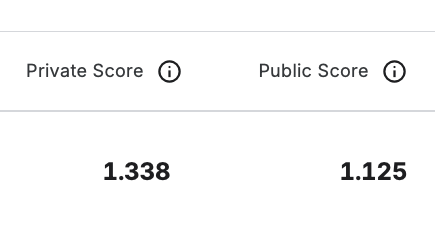
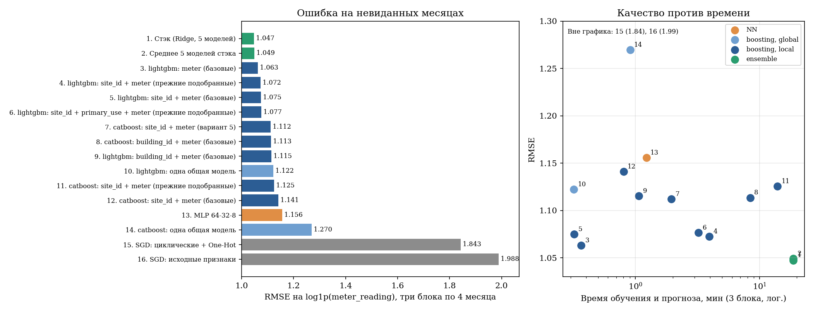

# ASHRAE — Great Energy Predictor III

> Эта же работа лежит отдельным репозиторием: [Denis-chupa/ashrae-energy-prediction](https://github.com/Denis-chupa/ashrae-energy-prediction).

Решение соревнования [ASHRAE — Great Energy Predictor III](https://www.kaggle.com/competitions/ashrae-energy-prediction) на Kaggle. Задача — по почасовым показаниям 2016 года у 1 449 зданий на 16 площадках и по погоде спрогнозировать четыре типа счётчиков (электричество, холодная вода, пар, горячая вода) на 2017–2018 годы. Метрика — RMSLE, то есть RMSE от `log1p(meter_reading)`; чем меньше, тем лучше. В обучении 20.2 млн строк, в тесте 41.7 млн.

Подробный разбор — в [PDF-отчёте](report/ashrae_energy_report.pdf) (7 страниц) и в разделах «Сравнение и выводы» и «Результаты на Kaggle» ноутбука [`research.ipynb`](research.ipynb).

## Результат

| Показатель | Значение |
|---|---:|
| Score | **1.125** |
| Позиция на private leaderboard | Top 29% |



Прирост 1.428 → 1.338 дали несколько изменений одновременно (сырая погода, час и день недели, чистка обучения, окно температуры 72 часа, ограничение прогноза); по отдельности на Kaggle они не мерились. Итоговая версия из этого репозитория (месяц, праздники, окна температуры, валидация блоками, стэк из 5 моделей) на Kaggle дала **Public 1.145 / Private 1.381 — хуже версии 3 (1.125 / 1.338)**, хотя на локальных блоках выглядела лучше. Какое из изменений виновато, по одной отправке сказать нельзя; главный подозреваемый — признак `month` (гипотеза: отправка без него не делалась). Файлы отправок по 260–270 МБ в Git не хранятся и приложены к [релизу отдельного репозитория](https://github.com/Denis-chupa/ashrae-energy-prediction/releases): `submission_private_1.338.csv.gz` (оценённая отправка) и `submission_final_blocks.csv.gz` (итоговая версия этого репозитория: 1.145 / 1.381).

Результаты берутся с Kaggle через CLI (история отправок и весь private leaderboard); сохранённые копии — в [`results/`](results/).

## Подход

### Baseline

Линейная модель `SGDRegressor` на исходных числовых признаках: RMSE **1.99**. Циклические час и направление ветра плюс One-Hot по зданию: **1.84**. Полиномиальные признаки степени 3 (отобраны `SelectKBest`) для линейной модели почти ничего не добавили: 1.69 против 1.68 на проверке «январь–сентябрь → октябрь–декабрь».

### Улучшения

- **Бустинги вместо линейной модели** и разделение по группам: общая модель, по `meter`, по `site_id + meter`, по зданиям.
- **Исправление времени погоды.** Метки времени погоды приведены к местному времени площадки, иначе суточный пик температуры не совпадает с пиком потребления.
- **Чистка обучения:** сбой site 0 (электричество до 20 мая) и серии нулей электричества и постоянных значений длиной от недели (`constant_run`): 2.8% строк.
- **Признаки:** сырая погода и строительные признаки с пропусками, час, день недели, среднее температуры за 3/24/72 часа, температура сутки назад, отклонение от среднего за 72 часа, праздники по странам площадок, месяц.
- **Валидация блоками месяцев** (три блока по 4 месяца) вместо «следующего месяца»: оценивает прогноз на сезон, которого модель не видела, и сильно ближе к Kaggle.
- **Подбор параметров** LightGBM и CatBoost на этих блоках и **стэк** (Ridge с неотрицательными весами) вместе с MLP.
- **MLP:** входы ограничены (`MLP_INPUT_CLIP = 5`): без этого кубы выбросов погоды давали на тесте прогнозы до 1e84.

### Финальное решение

Стэк из пяти моделей, веса метамодели обучены на половине `meta` трёх блоков:

| Модель | Вес | Параметры |
|---|--:|---|
| LightGBM по `site_id + meter` | 0.25 | `n_estimators=600`, `learning_rate=0.03`, `num_leaves=255`, `min_child_samples=100`, `colsample_bytree=0.85`, `subsample=0.7`, `reg_lambda=1` |
| LightGBM по `site_id + primary_use + meter` | 0.23 | те же |
| CatBoost по `site_id + meter` | 0.07 | `iterations=400`, `depth=4`, `learning_rate=0.1`, `l2_leaf_reg=3`, `rsm=0.7`, `one_hot_max_size=2` |
| CatBoost по `building_id + meter` | 0.19 | `iterations=100` (базовые) |
| MLP 64-32-8 | 0.25 | первые 100 полиномиальных признаков + циклические + One-Hot, 15 эпох |

На тесте (41.7 млн строк) бустинги обучаются заново на всём 2016 годе площадка за площадкой, прогноз каждой площадки сразу пишется на диск (`artifacts/test_parts/`), так что расчёт переживает падение ядра. Прогноз ограничивается максимумом `log1p` из train.

## Сравнение моделей

Одна схема для всех: три блока по 4 месяца 2016 года (обучение на двух, прогноз третьего), одни и те же строки и признаки. RMSE на `log1p` по половине `predict`; время — обучение и прогноз суммарно по трём блокам (MacBook M1, 8 ГБ). Время стэка — сумма времён его моделей; подбор параметров (LightGBM 25 мин, CatBoost 36 мин) в него не входит. Файл: [`results/model_comparison.csv`](results/model_comparison.csv).

| № | Модель | Класс | RMSE | блок 0 | блок 1 | блок 2 | Время, мин |
|--:|---|---|--:|--:|--:|--:|--:|
| 1 | **Стэк (Ridge, 5 моделей)** | ансамбль | 1.047 | 1.047 | 1.022 | 1.072 | 18.8 |
| 2 | **Среднее 5 моделей стэка** | ансамбль | 1.049 | 1.050 | 1.025 | 1.073 | 18.8 |
| 3 | lightgbm: meter (базовые) | бустинг, локальные | 1.063 | 1.053 | 1.048 | 1.088 | 0.4 |
| 4 | lightgbm: site_id + meter (прежние подобранные) | бустинг, локальные | 1.072 | 1.072 | 1.051 | 1.094 | 3.9 |
| 5 | lightgbm: site_id + meter (базовые) | бустинг, локальные | 1.075 | 1.069 | 1.047 | 1.108 | 0.3 |
| 6 | lightgbm: site_id + primary_use + meter (прежние подобранные) | бустинг, локальные | 1.077 | 1.069 | 1.046 | 1.114 | 3.2 |
| 7 | catboost: site_id + meter (вариант 5) | бустинг, локальные | 1.112 | 1.120 | 1.083 | 1.131 | 1.9 |
| 8 | catboost: building_id + meter (базовые) | бустинг, локальные | 1.113 | 1.118 | 1.085 | 1.136 | 8.4 |
| 9 | lightgbm: building_id + meter (базовые) | бустинг, локальные | 1.115 | 1.102 | 1.094 | 1.149 | 1.1 |
| 10 | lightgbm: одна общая модель | бустинг, одна модель | 1.122 | 1.141 | 1.100 | 1.125 | 0.3 |
| 11 | catboost: site_id + meter (прежние подобранные) | бустинг, локальные | 1.125 | 1.158 | 1.062 | 1.154 | 14.0 |
| 12 | catboost: site_id + meter (базовые) | бустинг, локальные | 1.141 | 1.173 | 1.080 | 1.168 | 0.8 |
| 13 | MLP 64-32-8 | нейросеть | 1.156 | 1.175 | 1.133 | 1.158 | 1.2 |
| 14 | catboost: одна общая модель | бустинг, одна модель | 1.270 | 1.296 | 1.257 | 1.255 | 0.9 |
| 15 | SGD: циклические + One-Hot | линейная | 1.843 | 1.686 | 2.006 | 1.823 | 0.1 |
| 16 | SGD: исходные признаки | линейная | 1.988 | 1.951 | 1.962 | 2.050 | 0.0 |

«базовые» — параметры по умолчанию; «прежние подобранные» — подобраны раньше на августе 2016; «вариант 5» — лучший из случайных вариантов на блоках.



## Что сработало лучше всего

- **Разделение по типу счётчика.** Общая LightGBM 1.122 → по `meter` 1.063: четыре счётчика по-разному зависят от погоды. Эта же модель — лучшая одиночная и самая дешёвая (0.4 мин).
- **Ансамбль разных моделей.** Стэк 1.047 против лучшей одиночной 1.063; простое среднее даёт 1.049, то есть выигрывает разнообразие, а не подбор весов. Средняя корреляция ошибок моделей стэка 0.88, MLP коррелирует с деревьями слабее (0.77–0.84).
- **Чистка нулей электричества:** 1.139 → 1.118 на общей LightGBM.
- **Месяц как признак:** −0.008 (100 деревьев) … −0.036 (400 деревьев, 127 листьев) на блоках месяцев. Оценка по одному году; на Kaggle итоговая версия с месяцем оказалась хуже (1.381 против 1.338), так что выигрыш на блоках не подтвердился (причина не доказана).
- **Схемы проверки внутри 2016 года завышают качество и не предсказывают порядок версий:** версия 3: 1.00 (следующий месяц) → 1.125 (public) → 1.338 (private); итоговая: 1.05 (блоки) → 1.145 → 1.381. Локально итоговая версия выглядела лучше, на Kaggle оказалась хуже.

## Что не сработало

- **Итоговая версия** (месяц, праздники, окна температуры, блоки месяцев, MLP на всём году): Private 1.381 против 1.338 у версии 3. Что именно ухудшило результат, неизвестно; следующий шаг — отправить тот же стэк без `month` и `is_holiday`.
- **Локальные модели по зданиям.** По `building_id + meter` LightGBM 1.115 против 1.063 по `meter`: на модель приходится около 420 строк.
- **CatBoost** хуже LightGBM при любой группировке и в 3–8 раз медленнее; большая модель (глубина 10, 600 итераций) хуже маленькой (1.126 против 1.112). Общая CatBoost со 100 итерациями — 1.270.
- **Подбор гиперпараметров LightGBM:** 1.075 → 1.072 ценой 13-кратного времени, меньше разброса между блоками.
- **Окна температуры и праздники:** в пределах ±0.003, день года хуже месяца ([`results/feature_ablation.csv`](results/feature_ablation.csv)).
- **Удаление постоянных ненулевых серий** по отдельности ухудшает (1.139 → 1.142–1.145); оставлено вместе с нулями по условию задачи ([`results/cleaning_ablation.csv`](results/cleaning_ablation.csv)).
- **MLP на 100 тыс. строк января–июля с весом 0.54** в первой отправке: переобучена на один сезон; в новой версии вес 0.25, обучена на всём году и с ограничением входов.

## Структура

| Файл | Назначение |
|---|---|
| [`research.ipynb`](research.ipynb) | Весь код: анализ, модели, валидация, тест, сравнение, Kaggle |
| [`prepare_data.py`](prepare_data.py) | Сырые CSV → `artifacts/*.parquet` (исполняет ячейки ноутбука по id) |
| [`run_cells.py`](run_cells.py) | Выполняет ячейки ноутбука по id в чистом процессе (так считались все этапы) |
| [`report/`](report/) | Генераторы рисунков и PDF-отчёта, готовый [PDF](report/ashrae_energy_report.pdf) |
| [`experiments/feature_ablation.py`](experiments/feature_ablation.py) | Проверка признаков общей LightGBM на блоках месяцев |
| [`results/`](results/) | Таблицы сравнения, отправки Kaggle, leaderboard, рисунки |
| [`artifacts/`](artifacts/) | Небольшие сохранённые состояния (настройки, MLP, стэк) |
| `best_params_*.json`, `polynomial_features_k10.json` | Подобранные параметры и отобранные полиномиальные признаки |

## Воспроизведение

Исходные расчёты шли на Python **3.13.3**, macOS arm64 (Apple M1, 8 ГБ), без GPU; MLP считалась на MPS. Полный прогон — около 1 часа валидации и 1.9 часа прогноза теста. Пиковая память подготовки данных — около 5 ГБ, поэтому на 8 ГБ закройте остальные приложения; для итоговых файлов нужно около 3 ГБ свободного диска.

### 1. Клонировать репозиторий и установить зависимости

```bash
git clone https://github.com/Denis-chupa/obesity-levels.git
cd obesity-levels/ashrae-energy-prediction
python3.13 -m venv .venv && source .venv/bin/activate
python -m pip install --upgrade pip
python -m pip install -r requirements-notebook.txt
```

### 2. Скачать данные

Примите правила соревнования на Kaggle и настройте авторизацию CLI (`~/.kaggle/` или переменные окружения Kaggle), затем:

```bash
kaggle competitions download -c ashrae-energy-prediction -p ashrae-energy-prediction
python -m zipfile -e ashrae-energy-prediction/ashrae-energy-prediction.zip ashrae-energy-prediction
```

Нужны `train.csv`, `test.csv`, `weather_train.csv`, `weather_test.csv`, `building_metadata.csv`.

### 3. Подготовить таблицы

```bash
python prepare_data.py          # ~2 мин; создаёт artifacts/train_full.parquet, test.parquet, weather_test_aligned.parquet
```

### 4. Валидация блоками месяцев, подбор, стэк, сравнение

```bash
python run_cells.py "resume-load,resume-common,77f0fdc2,6e5ba85e,34d14645,b997f820,mlp-predict-frame,cv-setup,cv-mlp,cv-boosting,cv-stack,af36ddf8,cmp-benchmark,cmp-plot,cmp-errors,kaggle-submissions,kaggle-leaderboard"
```

Прогнозы блоков кэшируются в `artifacts/cv_parts/`: после сбоя достаточно запустить команду снова. Ячейки `kaggle-*` используют CLI; без него берутся сохранённые CSV из `results/`.

### 5. Прогноз теста

```bash
python run_cells.py "test-resume-load,test-resume-defs,test-prepare,test-predict,test-submission"
```

Результат — `submission.csv.gz` (столбцы `row_id,meter_reading`). После падения выполните ту же команду снова: готовые площадки берутся из `artifacts/test_parts/`. Для записи файла нужно около 300 МБ свободного места.

### 6. Отчёт

```bash
python report/make_figures.py && python report/make_report.py     # report/ashrae_energy_report.pdf
```

### Замечания

- Детали ячеек можно смотреть и запускать в Jupyter, но полный ноутбук рассчитан на запуск по этапам выше: выводы новых ячеек (`cv-*`, `cmp-*`, `kaggle-*`) сохранены из этих запусков.
- Прогнозы MLP на MPS и многопоточных бустингов не побитово воспроизводимы; значения должны совпасть до третьего знака.
- `import lightgbm` вместе с многопоточными операциями PyTorch на CPU в macOS-окружении роняет процесс (две копии OpenMP): в коде стоит `torch.set_num_threads(1)`.
- Ключи Kaggle в репозиторий не входят (`.gitignore`).
